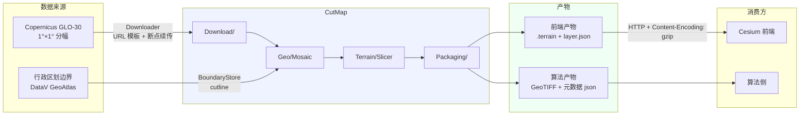
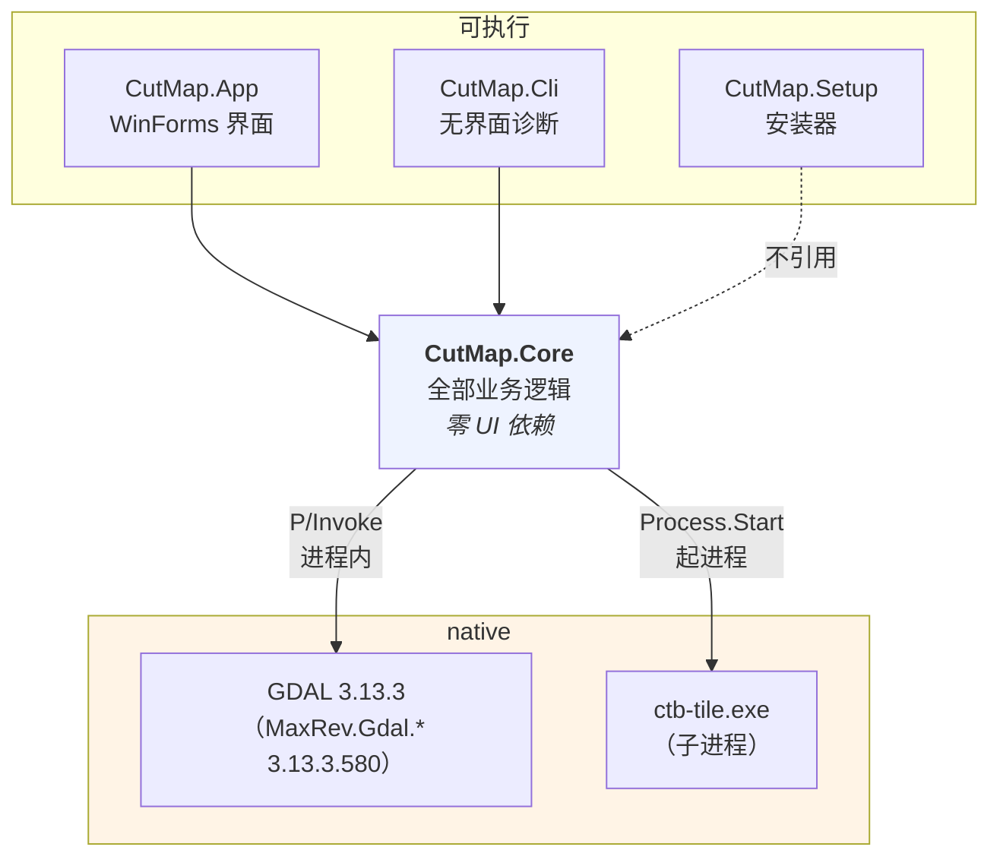
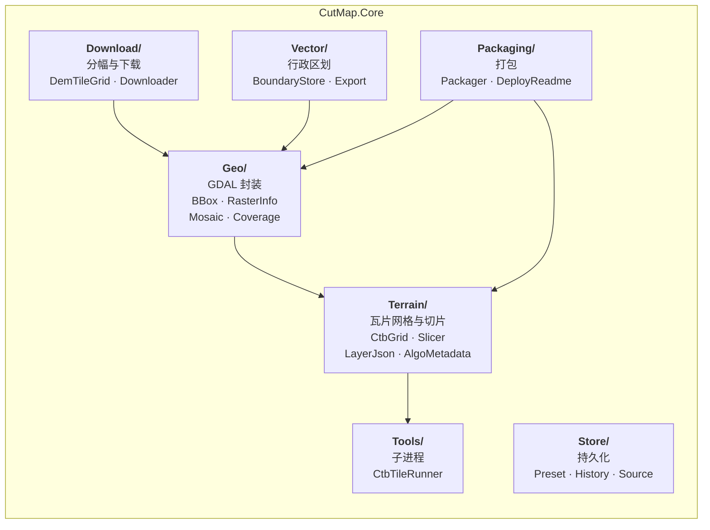
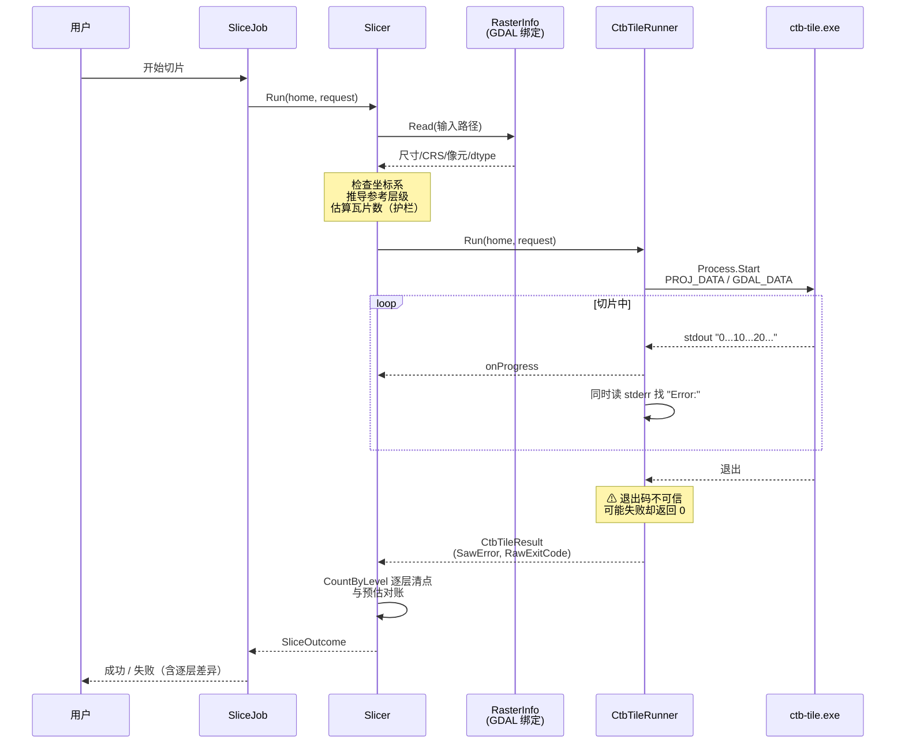
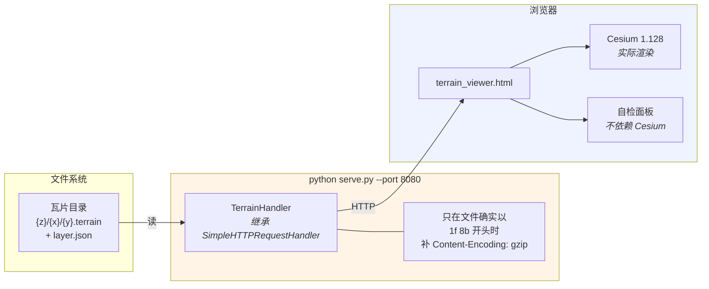
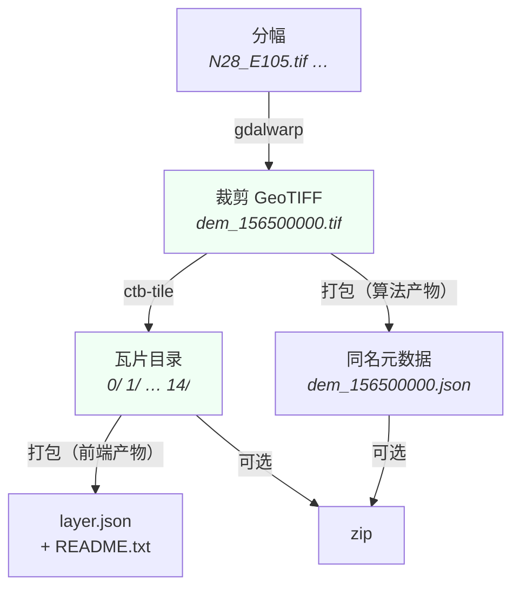

# CutMap 技术架构

> 本文只讲**结构与依赖关系**，不讲为什么这么选（那是
> [技术路线与交付.md](技术路线与交付.md) 的事），也不讲每个文件里有什么
> （那是 [开发与交接.md](开发与交接.md) 的事）。
>
> 图里写的是**真实的文件名与函数名**，不是示意。照着图能直接找到代码。

---

## 1 系统全景：数据从哪来、到哪去



**一句话**：左边进来原始分幅与边界，中间三步处理，右边出去两套互不相干的产物。

两套产物的**消费者不同**，这是设计的出发点：

| 产物 | 给谁 | 为什么需要 |
|---|---|---|
| 前端产物 | `CesiumTerrainProvider` | 渲染用，格式是 heightmap-1.0 |
| 算法产物 | Python GDAL 采样 | 判定用，格式是 GeoTIFF 栅格 |

---

## 2 代码分层：四个项目



**两条硬约束**，都在 `.csproj` 层面强制：

1. **`Core` 不许依赖 UI** —— `.csproj` 里没有 `UseWindowsForms`，破了编译不过。
   目的不是好看，是让 `CutMap.Cli` 能在没有窗口的环境里跑完全部验收。
2. **`Setup` 不引用 `Core`** —— 否则安装器会把整个程序拖进自己肚子里。
   代价是它自带一份最小的配色常量（见 `InstallerForm.cs` 顶部）。

### Core 的六个模块



**依赖方向**：`Packaging` 与 `Terrain` 在上，`Geo` 与 `Tools` 在下。
`Geo` 是唯一直接碰 GDAL 绑定的地方；`Tools` 是唯一启动子进程的地方。

---

## 3 运行时调用链：一次切片

这是最值得看的一张——**失败检测点就藏在里面**。



### 图里那两个 Note 是整个设计的关键

**① 退出码不可信。** CTB 源码 `tools/ctb-tile.cpp` 的 `runTiler()` 有两条失败路径，
行为**不一致**：

```cpp
if (poDataset == NULL) { cerr << "Error: ..."; return 1; }   // 打开失败 → 1
try { ...切片... }
catch (CTBException &e) { cerr << "Error: " << e.what(); }   // 只打印
return 0;                                                     // ← 照样返回 0
```

所以 `CtbTileRunner` **以 stderr 为准**。

**② 对账是第二道防线。** stderr 抓"明确报错"，瓦片数对账抓"没报错但结果不全"。
两条都要有——`cli ctb-gate` 用「缺坐标系的栅格」**实测复现**了返回 0 那条路径。

---

## 4 预览页：`terrain_viewer.html` 的位置

你特别问的那一页。它**不在软件进程里**，是一条完全独立的链路：



### 三个要点

1. **它不是软件的一部分**，是仓库里的辅助工具。软件产出瓦片，它负责"看一眼"。
2. **必须经 HTTP**：浏览器不允许页面直接读本地文件，所以双击 HTML 打不开，得先起 `serve.py`。
3. **`serve.py` 存在的唯一理由是那个 gzip 响应头**。缺它，瓦片请求全是 200、
   `layer.json` 也解析正常，**但屏幕上一片空白**（README §6.5 记录的故障）。
   `python -m http.server` 不会有这个头。

### 页面内部的三段

| 段 | 行 | 依赖 Cesium？ | 作用 |
|---|---|---|---|
| 配置 | `:55` | — | `TERRAIN_URL` / `WORLD_CENTER` / `MAXZOOM` |
| **数据自检** | `:77` 起 | **不依赖** | 绕过 Cesium 直接 fetch 瓦片，查是否已解压、字节数是否 8452；四角取点解高程与源 DEM 对照 |
| 主流程 | `:287` 起 | 依赖 | 起 Cesium、加载 terrain provider |

**中间那一段不依赖 Cesium**——这是它作为交付物的价值所在：**断网时 3D 渲染会失败，但数据自检照跑**，至少能回答"数据本身对不对"。

### 现状：五处写死（见 [通用性验收.md](通用性验收.md) C6）

```javascript
const TERRAIN_URL  = './data/outputs/cesium_terrain/';   // 路径
const WORLD_CENTER = { lon: 107.75, lat: 30.15 };        // 镜头（重庆）
const MAXZOOM      = 14;
// 4 个采样点（含期望高程）与自检项 14/25968/10752 —— 全是重庆专属
```

换一个瓦片集，**镜头仍会飞到重庆**，而自检项 `14/25968/10752` 会变成一个合法的 404
被报成失败。批次 2 要把这五处全部改成从 `layer.json` 推导。

---

## 5 数据流：一次完整任务的产物落点



**落点口径**（`AlgoMetadata`、`LayerJson` 决定）：

- **元数据 json 与 tif 同名同目录**——算法侧拿到 tif 就顺带拿到了 json，不会走散
- **layer.json 写在瓦片目录里**——Cesium 从 `<terrain>/layer.json` 取
- **算法产物不与瓦片目录混在一起**——`打包` 只是把 zip 放到指定目录，不挪动源文件
- **`layer.json` 是「打包」的产物，不是切片的副产物**——所以切片完不打包就没有它，
  而预览页需要它

---

## 6 外部依赖一览

| 依赖 | 形态 | 版本 | 在哪 |
|---|---|---|---|
| GDAL | NuGet，进程内 P/Invoke | **3.13.3**（包 3.13.3.580） | `Core.csproj` |
| ctb-tile | 子进程，随包分发 | CTB 0.4.1 | `ctb/bin/` |
| .NET 运行时 | 自包含，随包分发 | 8.0 | 发布目录 |
| PROJ / GDAL 数据 | 文件，随包分发 | — | `ctb/share/` |
| Cesium | CDN（**批次 2 要落到本地**） | 1.128 | `terrain_viewer.html:9` |
| OSM 底图 | 在线瓦片（**批次 2 要默认关闭**） | — | `terrain_viewer.html:332` |

**GDAL 版本必须钉死 3.13.3**：基线的 Checksum 58775 是验收锚点，
换版本就要重新赌 warp 内核是否一致。升级这个包**必须重跑 `warp-gate`**。
